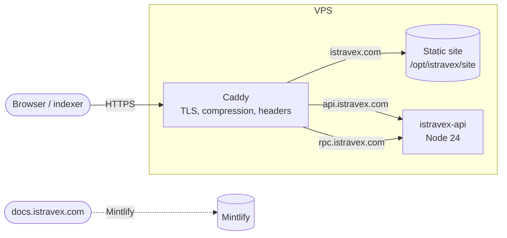

Production is one VPS running Docker Compose, deployed by GitHub Actions after CI passes on `main`. There's no manual step in the normal path: merge to `main`, and a few minutes later the site, API and RPC are running that commit.

## What runs where



| Host | Served by |
|---|---|
| `istravex.com` | Caddy, static files from `npm run build` |
| `www.istravex.com` | Redirect to `istravex.com` |
| `api.istravex.com` | Caddy → `istravex-api` container |
| `rpc.istravex.com` | Caddy → `istravex-api`, path rewritten to `/rpc/…` |
| `docs.istravex.com` | Mintlify, from `docs/` in this repository |

Caddy obtains and renews TLS certificates automatically. The stack is defined in `deploy/compose.yml` and `deploy/Caddyfile`.

## The pipeline

`.github/workflows/deploy.yml` runs when the CI workflow completes successfully on `main`, or manually from the Actions tab.

<Steps>
  <Step title="Build the API image">
    Built from the `Dockerfile` and pushed to `ghcr.io/hackcat29/istravex-api`, tagged with the commit SHA and `latest`.
  </Step>
  <Step title="Build the site">
    `npm run build`, uploaded as a workflow artifact.
  </Step>
  <Step title="Ship">
    Over SSH (strict host-key checking against a pinned `known_hosts`), rsync the site to `/opt/istravex/site` and the stack files to `/opt/istravex`.
  </Step>
  <Step title="Start">
    `deploy/remote.sh` runs on the server. It installs Docker if it's missing, writes the image tag to `.env`, logs in to GHCR with the workflow's short-lived token, pulls, and runs `docker compose up -d --wait`, which only returns once the API's health check passes.
  </Step>
  <Step title="Smoke test">
    The workflow checks that `https://api.istravex.com/v1/health` reports the commit just deployed, that the site responds, and that the RPC reports healthy. Any failure fails the deploy.
  </Step>
</Steps>

Deploys are serialised (`concurrency: deploy-production`), so two merges in quick succession deploy in order.

## One-time setup

<Steps>
  <Step title="DNS">
    Point the four web hosts at the VPS:

    | Type | Name | Value |
    |---|---|---|
    | A | `istravex.com` | VPS IPv4 |
    | A | `www`, `api`, `rpc` | VPS IPv4 |
    | AAAA | `istravex.com`, `www`, `api`, `rpc` | VPS IPv6 (optional) |

    `docs` is a CNAME to Mintlify; see [Docs](/operations/docs).
  </Step>
  <Step title="Firewall">
    Allow inbound 22 (SSH), 80 and 443 (TCP), and 443/UDP for HTTP/3, in the VPS provider's firewall. Alternatively set the repository variable `CONFIGURE_UFW=true` and `remote.sh` configures `ufw` on the server.
  </Step>
  <Step title="Deploy key">
    Generate a key pair just for deploys and authorise it on the server:

    ```bash
    ssh-keygen -t ed25519 -N '' -C istravex-deploy -f istravex-deploy
    ssh-copy-id -i istravex-deploy.pub root@<VPS IPv4>
    ssh-keyscan -t ed25519,ecdsa,rsa <VPS IPv4> > known_hosts
    ```
  </Step>
  <Step title="Repository secrets and variables">
    In **Settings → Secrets and variables → Actions**:

    | Kind | Name | Value |
    |---|---|---|
    | Secret | `VPS_HOST` | VPS IPv4 |
    | Secret | `VPS_USER` | `root`, or a sudo-capable user |
    | Secret | `VPS_SSH_KEY` | Contents of `istravex-deploy` (the private key) |
    | Secret | `VPS_KNOWN_HOSTS` | Contents of `known_hosts` |
    | Variable | `DEPLOY_ENABLED` | `true` |

    Then delete the private key from your machine. The deploy job is skipped until `DEPLOY_ENABLED` is `true`, so the pipeline is safe to merge before the server is ready.
  </Step>
  <Step title="Package visibility">
    After the first deploy, make the `istravex-api` package public in GitHub (**Packages → istravex-api → Package settings**) if you want others to `docker pull` it. The server pulls with a token either way.
  </Step>
</Steps>

## Operating it

```bash
ssh root@<VPS IPv4>
cd /opt/istravex
docker compose ps                 # status and health
docker compose logs -f api        # JSON request logs
docker compose logs -f caddy      # TLS and proxy logs
```

**Roll back** by re-running the Deploy workflow on an earlier commit (Actions → Deploy → Run workflow), or on the server:

```bash
echo "TAG=<earlier sha>" > .env && docker compose up -d --wait
```

**Resources.** The API holds the corpus metadata in memory and decompresses at most four ledgers at a time; it runs comfortably in under 200 MB. Container logs rotate at 5 × 10 MB.
