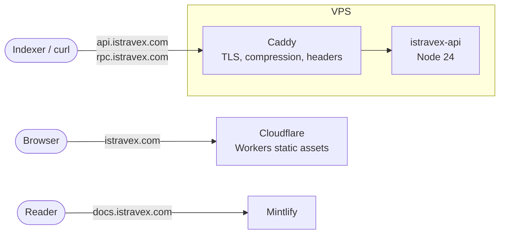

Production is split by what each part needs. The site is static, so it lives on Cloudflare's edge. The API and mock RPC are a small Node service, so they run on a VPS. Both are deployed by one GitHub Actions workflow after CI passes on `main`: merge, and a few minutes later everything is running that commit.

## What runs where



| Host | Served by | Deployed by |
|---|---|---|
| `istravex.com`, `www.istravex.com` | Cloudflare Workers static assets (`wrangler.jsonc`) | `wrangler deploy` in the Deploy workflow |
| `api.istravex.com` | Caddy → `istravex-api` container on the VPS | Deploy workflow, over SSH |
| `rpc.istravex.com` | Same container; Caddy rewrites the path to `/rpc/…` | Deploy workflow, over SSH |
| `docs.istravex.com` | Mintlify, from `docs/` | Mintlify's GitHub app, on push |

The DNS zone is on Cloudflare. The site's records are created by Cloudflare when the Worker's custom domains are attached; `api` and `rpc` are created by the workflow (`deploy/dns.mjs`) as **DNS-only** records, so Caddy terminates TLS itself and sees real client addresses for rate limiting.

## The site on Cloudflare

`wrangler.jsonc` deploys `dist/` as static assets with no Worker script:

- `not_found_handling: single-page-application`, so every path serves the app;
- custom domains `istravex.com` and `www.istravex.com`, with `workers.dev` and preview URLs off;
- `public/_headers` (copied into `dist/`) sets HSTS, `nosniff`, a referrer policy, `X-Frame-Options: DENY`, and a one-year immutable cache on Vite's fingerprinted `/assets/*`. Everything else revalidates on every request.

CI runs `wrangler deploy --dry-run` on every push, so a broken config fails before merge.

## The pipeline

`.github/workflows/deploy.yml` runs when CI completes successfully on `main`, or manually from the Actions tab. Its three jobs run in parallel where they can.

<Steps>
  <Step title="Site → Cloudflare">
    `npm run build`, validate with `wrangler deploy --dry-run`, then `wrangler deploy --message <commit>`. The first deploy attaches the custom domains, replacing any placeholder records at those names. A smoke test fetches `https://istravex.com/`.
  </Step>
  <Step title="API image → GHCR">
    Built from the `Dockerfile` and pushed to `ghcr.io/hackcat29/istravex-api`, tagged with the commit SHA and `latest`.
  </Step>
  <Step title="API → VPS">
    Upserts the `api` and `rpc` DNS records, then over SSH (strict host-key checking against a pinned `known_hosts`) copies `deploy/` to `/opt/istravex` and runs `deploy/remote.sh`. That script installs Docker if it's missing, logs in to GHCR with the workflow's short-lived token, pulls the image for this commit, and runs `docker compose up -d --wait`, which only returns once the API's health check passes. A smoke test then requires `https://api.istravex.com/v1/health` to report the commit just deployed, and the RPC to report healthy.
  </Step>
</Steps>

Deploys are serialised (`concurrency: deploy-production`), so two merges in quick succession deploy in order. Each part is skipped, not failed, until it's configured.

## One-time setup

<Steps>
  <Step title="Cloudflare API token">
    In the Cloudflare dashboard, **My Profile → API Tokens → Create Token**, start from the **Edit Cloudflare Workers** template, add **Zone → DNS → Edit**, and limit it to your account and the `istravex.com` zone. Store it in GitHub:

    ```bash
    gh secret set CLOUDFLARE_API_TOKEN --repo hackcat29/istravex
    gh variable set CLOUDFLARE_ACCOUNT_ID --repo hackcat29/istravex --body <account id>
    ```

    `npx wrangler whoami` prints the account ID.
  </Step>
  <Step title="VPS access">
    Generate a key just for deploys, authorise it on the server, and pin the host keys:

    ```bash
    ssh-keygen -t ed25519 -N '' -C istravex-deploy -f istravex-deploy
    ssh-copy-id -i istravex-deploy.pub root@<VPS IPv4>
    ssh-keyscan -t ed25519,ecdsa,rsa <VPS IPv4> > known_hosts
    ```

    Compare the scanned fingerprints (`ssh-keygen -lf known_hosts`) with the server's own (`ssh-keygen -lf /etc/ssh/ssh_host_ed25519_key.pub`, from the provider's console) before trusting them.
  </Step>
  <Step title="Repository secrets and variables">
    | Kind | Name | Value |
    |---|---|---|
    | Secret | `VPS_HOST` | VPS IPv4 |
    | Secret | `VPS_USER` | `root`, or a sudo-capable user |
    | Secret | `VPS_SSH_KEY` | The private key `istravex-deploy` |
    | Secret | `VPS_KNOWN_HOSTS` | Contents of `known_hosts` |
    | Variable | `VPS_IPV6` | VPS IPv6 (optional; adds AAAA records) |
    | Variable | `DEPLOY_ENABLED` | `true` |

    Then delete the private key from your machine.
  </Step>
  <Step title="Firewall">
    Allow inbound 22, 80 and 443 (TCP) and 443/UDP in the VPS provider's firewall, or set the variable `CONFIGURE_UFW=true` and `remote.sh` configures `ufw`.
  </Step>
  <Step title="Docs domain">
    See [Docs](/operations/docs#publishing). In Cloudflare, keep the `docs` CNAME **DNS-only**: Mintlify issues its own certificate.
  </Step>
</Steps>

## Operating it

**Site.** `npx wrangler deployments list` shows recent deploys; `npx wrangler rollback` returns to the previous one instantly.

**API.**

```bash
ssh root@<VPS IPv4>
cd /opt/istravex
docker compose ps                 # status and health
docker compose logs -f api        # JSON request logs
docker compose logs -f caddy      # TLS and proxy logs
```

Roll back by re-running the Deploy workflow on an earlier commit, or on the server:

```bash
echo "TAG=<earlier sha>" > .env && docker compose up -d --wait
```

**Resources.** The API holds corpus metadata in memory and decompresses at most four ledgers at a time; it runs comfortably in under 200 MB. Container logs rotate at 5 × 10 MB.
