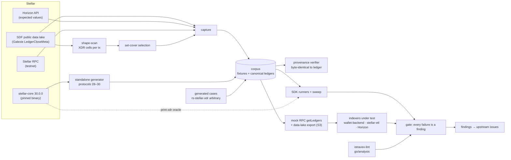

Istravex is a test kit for software that reads the Stellar ledger: SDKs that decode XDR, and indexers that turn ledgers into records. Everything is driven by real ledger data, and every expected value comes from outside the software under test.

## Data flow

## Where Stellar is used

| Stellar component | How Istravex uses it | Code |
|---|---|---|
| SDF public data lake (Galexie layout, `LedgerCloseMeta`) | Source of every mainnet and testnet fixture's bytes; streamed by the shape scanner (400,311 ledgers) and the sweep | `kit/go/cmd/shape-scan`, `kit/lib/ledger.mjs`, `kit/sweep` |
| Horizon API | Expected values for set-cover fixtures (hash, outcome, fees, operations, effects), so no SDK under test grades itself | `kit/capture/tx.mjs`, `kit/capture/shapes.mjs` |
| stellar-core 30.0.0 (pinned by sha256) | Standalone network that generates byte-reproducible fixtures at protocols 28–30; `print-xdr` as the oracle for generated cases; `--check-lcm` goldens | `kit/capture/generate.mjs`, `kit/cases/core-oracle.mjs`, `kit/goldens` |
| Stellar RPC | Testnet capture; and the protocol the kit's mock server speaks (`getHealth`, `getNetwork`, `getLatestLedger`, `getLedgers`), so an indexer replays the corpus unchanged | `kit/rpc` |
| Galexie data-lake format | The kit exports the corpus in the same layout, on disk or over a read-only S3 endpoint, for indexers that use the datastore ledger backend | `kit/datalake/lake.mjs` |
| XDR and SDKs | Seven SDK runners: `@stellar/stellar-sdk`, `go-stellar-sdk`, `stellar-xdr` (Rust), Python `stellar-sdk` and `stellar-xdr`, `java-stellar-sdk`, `stellar-php-sdk` | `kit/runners/*`, `kit/go/cmd/conformance` |
| Indexers | wallet-backend's own `ProcessLedger` (RPC and datastore backends); stellar-etl's own transforms; Horizon's own `db reingest range` into PostgreSQL | `kit/pilot/*` |
| Soroban | A probe contract, rebuilt byte for byte in CI, that the standalone generator calls to produce the generated Soroban fixtures | `kit/capture/contracts/probe` |
| CAPs | Every XDR cell is mapped to the CAP that introduced it; coverage is audited per CAP | `kit/audit` |

## Components

| Layer | What it is | Language |
|---|---|---|
| Corpus | `corpus/fixtures` (137 fixtures with manifests), `corpus/ledgers` (canonical ledgers), `corpus/generated` (45,144 cases), `corpus/scan` (cell scans), JSON Schema | Data |
| Capture and generation | Scanner, set cover, capture from data lake + Horizon + RPC, standalone generator, case generator | Go, Node, Rust |
| Verification | Provenance verifier (schema, sha256, protocol, byte equality with the canonical ledger) | Go |
| Conformance | One runner per SDK; the sweep over whole ledgers against stellar-core's transaction hashes; JavaScript release matrix | JS, Go, Rust, Python, Java, PHP |
| Replay | Mock RPC, data-lake export, scorer, reference and naive indexers, upstream pilots | Node, Go |
| Linting | `istravex-lint` (IX001–IX003) as a `go/analysis` analyzer, a GitHub Action and a reusable workflow | Go |
| Gate and findings | `kit/check-results.mjs`: every failing check maps to a finding in `corpus/findings.json`, and every finding's claim must still fail | Node |
| Hosted | istravex.com (Cloudflare Workers), docs.istravex.com (Mintlify), api.istravex.com and rpc.istravex.com (one read-only container) | TS, Node |
| CI/CD | GitHub Actions: CI on every push, scans, sweeps, sightings, weekly monitor, signed releases | YAML |

Security and monitoring: [threat model](/project/threat-model).

## What the funded work adds

| Addition | Architecture | Stellar integration |
|---|---|---|
| Conformance jobs in the SDK and indexer repositories | The reusable workflow, parameterised per repository: checkout of the project under test, the kit's runner for it, the gate in "report" mode on pull requests | Each SDK's own XDR decode/encode API; each indexer's own ingestion entry point |
| Swift, Dart, .NET and Kotlin runners | Same contract as the existing runners: read `corpus/fixtures` and `corpus/generated`, write `corpus/results/<sdk>.json` | `stellar-ios-mac-sdk`, `stellar_flutter_sdk`, `dotnet-stellar-sdk`, the Kotlin SDK |
| TypeScript linter | ESLint plugin with the IX rules, plus IX004–IX006 in both Go and TypeScript, each with seeded violations in CI | Patterns specific to `@stellar/stellar-sdk` indexers: amounts, effects, strkeys, memos |
| More indexer pilots | Adapter → mock RPC or data lake → scorer, as for the three existing pilots | SDF's token transfer processor (CAP-0067 events) and two community indexers |
| Automatic coverage | Weekly `shape-scan` of new ledgers → for each new cell, `kit/capture/shapes.mjs` captures a fixture, the verifier proves it, and a pull request is opened | SDF data lake and Horizon |
| Protocol upgrades | Re-pin stellar-core, SDKs and indexers; rescan; regenerate; rerun; release within two weeks of the mainnet vote | stellar-core releases, new CAPs |
