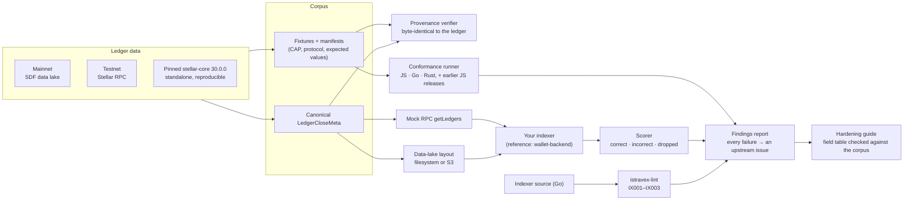

**Istravex — The XDR conformance and replay kit for Stellar**

### Project summary

Istravex is an open-source test kit that helps Stellar indexer and SDK maintainers verify that their software preserves what actually happened on the ledger. It uses a shared, versioned corpus of rare but valid Stellar XDR to answer two questions. Does the SDK decode and re-encode the data faithfully? Does the indexer store the right records and attribute them to the right accounts?

Built for **SCF #46 RFP 2** (XDR/CAP-Coverage Audit Tool and Indexer-Hardening Guide). Everything below is built, public and running in CI: the corpus and its reproducible generator, the replay harness, the JavaScript, Go and Rust conformance runner, the Go linter, the hardening guide, and a findings report. The grant would fund growing the corpus across the remaining CAPs and maintaining the kit through the next protocol upgrade.

- Repository: https://github.com/hackcat29/istravex (Apache 2.0)
- Docs: https://docs.istravex.com · API: https://api.istravex.com · Mock RPC: https://rpc.istravex.com

### Problem

A Stellar transaction can be valid and still be misread downstream. An indexer might miss a trustline created through a Stellar Asset Contract, store a muxed address where an account belongs, or attribute an effect to the wrong account. An SDK can decode an XDR value correctly and still lose information when it converts it to a language-native value. These mistakes propagate into wallets, explorers and analytics without a visible error, and in 2026 several of them halted production ingestion outright.

A regression test added to one SDK or indexer usually stays in that repository. Istravex lets maintainers share the original fixture, its expected result and the protocol context behind it, so a fix in one implementation becomes a test for all of them.

### What it does

**In plain English.** The corpus is a folder of real Stellar transactions and ledger entries, each tied to the protocol change (CAP) that introduced its shape, with the values a correct decoder and a correct indexer must produce. A verifier proves every one is byte-identical to the ledger that recorded it. Three small programs, one per SDK language, decode every fixture and check the values. A fake Stellar RPC server, and an export in the same layout as SDF's public data lake, hand the same ledgers to any indexer, and a scorer compares what it stored with what it should have. A linter reads indexer source code for the mistakes that keep recurring. A findings file ties every failure to an issue upstream, and a guide explains each rule with the evidence.

**Stack.** Node 24 (corpus tooling, mock RPC, data-lake exporter, JavaScript runner, API), Go 1.25 (verifier, Go runner, `go/analysis` linter), Rust (stellar-xdr runner, the Soroban probe contract), stellar-core 30.0.0 pinned by binary sha256, `@stellar/stellar-sdk` 17.4.0, `go-stellar-sdk` 0.9.0, `stellar-xdr` 30.0.0, Mintlify for docs, GitHub Actions for CI and deploys.

### What's built

| Deliverable | What exists | RFP reviewer check |
|---|---|---|
| **Corpus and generator** | 15 fixtures across 6 CAPs and 13 patterns: 2 mainnet, 2 testnet, 9 generated, 2 synthetic. The generator runs a pinned standalone stellar-core, is byte-reproducible (seeded keys, fixed close times), takes any network passphrase, and needs no network, keys or funds. 152/152 provenance checks. | Every fixture round-trips through rs-stellar-xdr 30.0.0; all three SDKs round-trip stellar-core's 15,306 `--check-lcm` golden frames. |
| **Replay harness** | Mock Stellar RPC `getLedgers` and the Galexie data-lake layout (filesystem or S3), bounded memory (542 MB of ledgers served under a 128 MB heap). Reference adapter: wallet-backend's own ingestion, 8/8 correct over both inputs. | wallet-backend #729, #731 and #716 reproduce on the commits before their fixes and pass on the fixes, in CI. |
| **Linter** | Three `go/analysis` rules: unvalidated fields used as if checked (IX001), walks with no depth or size limit (IX002), participants or fees from the envelope (IX003). A GitHub Action and a reusable workflow. | Flags all six seeded violations; clean on current wallet-backend apart from one triaged latent finding; flags the code #753 and 9538b3c fixed, on the commits before them. |
| **Hardening guide** | Nine rules, a field-by-field table of what stellar-core validates and passes through, recommended limits with sources, SEP-0023 address handling, a checklist. Exports to Docusaurus for developers.stellar.org. | The field table is generated from one file and CI checks it against every manifest. Reviewed and confirmed by a Stellar Core engineer (version 1.0 on 14 November, version 1.1 on 15 November 2026). |
| **Conformance runner** | JavaScript, Go and Rust in CI, named checks per pattern, plus four JavaScript releases. | js-stellar-sdk 17.2.0 and 17.2.1 fail exactly the checks for #1766, #1785 and #1789; 17.3.0 and 17.4.0 pass. |
| **Findings report** | 15 findings with severity, affected versions, the minimal corpus entry and the checks each explains; served at `/v1/findings`. | CI fails on any reproduced failure that no finding explains. Three new findings are filed upstream: stellar-core#5507 and #5508, js-stellar-sdk#1906. |

### Evidence of reproducing a listed sighting

All six sightings the RFP's deliverable checks name reproduce in CI, failing before the fix and passing after:

- **wallet-backend #729** (signed-payload signers): on `2a0a84e` the signer's state change can't be encoded (a 68-byte key into a 33-byte column), so ingestion would retry the ledger forever. On `2c87335`: correct.
- **wallet-backend #731** (SAC trustlines): on `764a4f5` no `TRUSTLINE` state change is recorded. On `c152783`: correct.
- **wallet-backend #716** (fixed by #753): on `f8e5786` the muxed source's `G…` and `M…` forms collide on one participant key, which halted ingestion; IX003 flags the four lines #753 changed. On `bb0b162`: correct, and no findings.
- **js-stellar-sdk #1766, #1785, #1789**: 17.2.0 throws decoding a valid pool-share trustline and mis-sorts map keys; 17.2.1 accepts `0x…` muxed IDs, rounds offer IDs above 2⁵³, and silently drops two of ten map entries. 17.3.0 passes every check.

### Infrastructure and decentralization

Nothing in the kit depends on a server Istravex runs. Every tool runs locally or in a user's CI from a clone: the corpus, verifier, runners, mock RPC, data-lake exporter, scorer and linter. The hosted services are conveniences over the same files: istravex.com (static site, Cloudflare Workers), docs.istravex.com (Mintlify), and api.istravex.com and rpc.istravex.com (one read-only container on a VPS, deployed by GitHub Actions, and self-hostable as one Docker image). Mainnet fixtures are pinned to SDF's public data lake by sha256, so anyone can re-derive them independently.

### User tracking

Minimal, and documented at https://docs.istravex.com/project/maintenance#user-tracking. Istravex adds no cookies, analytics or request logs anywhere: Cloudflare Workers observability and nginx access logs are off. The API keeps a per-IP rate-limit counter in memory for one minute. Mintlify records docs page views for its own dashboard, as it does for every site it hosts. The kit's tools collect nothing.

### Delivery milestones

| Milestone | Acceptance criteria | Status |
|---|---|---|
| **1. Corpus and reference replay** | Starter corpus, fixture generator, manifest schema and reference adapter. A clean checkout validates fixture provenance and replays the same sequence offline with stable results. | Done; regeneration proven byte-identical in CI |
| **2. Conformance and linting** | JavaScript, Go and Rust run the shared corpus in CI with a per-fixture results matrix. The Go linter flags fixtures for all three rules and passes on the agreed clean reference. | Done, with release matrices and pre-fix calibration |
| **3. Upstream pilot and public release** | wallet-backend findings with upstream links, engineering review of the guide, a tagged release with adapter documentation and CI templates. | Done: v1.0.0 and v1.1.0, guide reviewed |
| **4. Coverage and the next protocol** (funded work) | From 5 to 12 of the 40 XDR-changing CAPs; Python and Java runners; stellar-etl replayed through the data lake; the next protocol upgrade covered end to end within two weeks of its mainnet vote. | Planned |

### Open-source maintenance

Apache 2.0, developed in public, with tagged releases and a public changelog. A named maintainer owns fixture review, dependency updates, issue triage and releases for six months after delivery, through the first protocol upgrade after it. On that upgrade, every step is a command and CI stays red until it's done: audit the new CAPs, re-pin stellar-core, move the SDK pins and the probe contract, regenerate (and prove regeneration reproducible on both platforms), re-run the pilot, triage any new failure into a finding with an upstream issue, and release. Progress is posted to the Stellar community with each release.
