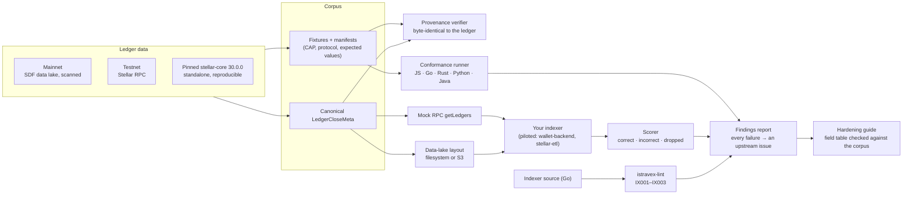

**Istravex — The XDR conformance and replay kit for Stellar**

### Project summary

Istravex is an open-source test kit that helps Stellar indexer and SDK maintainers verify that their software preserves what actually happened on the ledger. It uses a shared, versioned corpus of rare but valid Stellar XDR to answer two questions. Does the SDK decode and re-encode the data faithfully? Does the indexer store the right records and attribute them to the right accounts?

Built for **SCF #46 RFP 2** (XDR/CAP-Coverage Audit Tool and Indexer-Hardening Guide). Everything below is built, public and running in CI: a mainnet-first corpus and its reproducible generator, a mainnet history scanner, the replay harness with two upstream indexers, a conformance runner for five SDKs, the Go linter, the hardening guide, a findings report and a security policy. The grant would fund six months of new work: more CAPs, more SDKs and indexers, three more lint rules, and the next protocol upgrade.

- Repository: https://github.com/hackcat29/istravex (Apache 2.0)
- Docs: https://docs.istravex.com · API: https://api.istravex.com · Mock RPC: https://rpc.istravex.com

### Problem

A Stellar transaction can be valid and still be misread downstream. An indexer might miss a trustline created through a Stellar Asset Contract, store a muxed address where an account belongs, or attribute an effect to the wrong account. An SDK can decode an XDR value correctly and still lose information when it converts it to a language-native value. These mistakes propagate into wallets, explorers and analytics without a visible error, and in 2026 several of them halted production ingestion outright.

A regression test added to one SDK or indexer usually stays in that repository. Istravex lets maintainers share the original fixture, its expected result and the protocol context behind it, so a fix in one implementation becomes a test for all of them.

### What it does

**In plain English.** The corpus is a folder of real Stellar transactions and ledger entries, each tied to the protocol change (CAP) that introduced its shape, with the values a correct decoder and a correct indexer must produce. A verifier proves every one is byte-identical to the ledger that recorded it. Five small programs, one per SDK, decode every fixture and check the values. A fake Stellar RPC server, and an export in the same layout as SDF's public data lake, hand the same ledgers to any indexer, and a scorer compares what it stored with what it should have. A linter reads indexer source code for the mistakes that keep recurring. A findings file ties every failure to an issue upstream, and a guide explains each rule with the evidence.

**Stack.** Node 24 (corpus tooling, mock RPC, data-lake exporter, JavaScript runner, API), Go 1.25 (verifier, Go runner, `go/analysis` linter), Rust (stellar-xdr runner, the Soroban probe contract), Python 3 and Java 17 (their SDK runners), stellar-core 30.0.0 pinned by binary sha256, `@stellar/stellar-sdk` 17.4.0, `go-stellar-sdk` 0.9.0, `stellar-xdr` 30.0.0, Python `stellar-sdk` 17.0.1, `java-stellar-sdk` 6.0.0, Mintlify for docs, GitHub Actions for CI and deploys.

### What's built

| Deliverable | What exists | RFP reviewer check |
|---|---|---|
| **Corpus and generator** | 20 fixtures across 6 CAPs and 14 patterns: 6 from mainnet, 2 testnet, 10 generated, 2 synthetic. The generator runs a pinned standalone stellar-core at mainnet's protocol 29, is byte-reproducible (seeded keys, fixed close times), takes any network passphrase and protocol 28–30, and needs no network, keys or funds. 205/205 provenance checks. | Every fixture round-trips through rs-stellar-xdr 30.0.0; all SDKs round-trip stellar-core's 15,306 `--check-lcm` golden frames. |
| **Replay harness** | Mock Stellar RPC `getLedgers` and the Galexie data-lake layout (filesystem or S3), bounded memory (542 MB of ledgers served under a 128 MB heap). Two upstream indexers replayed: wallet-backend's own ingestion, 11/11 correct over both inputs; stellar-etl v2.8.34's own transforms, 7/11, the four misses being its open issues #454 and #460. | wallet-backend #729, #731 and #716 reproduce on the commits before their fixes and pass on the fixes, in CI. |
| **Linter** | Three `go/analysis` rules: unvalidated fields used as if checked (IX001), walks with no depth or size limit (IX002), participants or fees from the envelope (IX003). A GitHub Action and a reusable workflow. | Flags all six seeded violations; clean on current wallet-backend apart from one triaged latent finding; flags the code #753 and 9538b3c fixed, on the commits before them. |
| **Hardening guide** | Nine rules, a field-by-field table of what stellar-core validates and passes through (14 rows), recommended limits with sources, SEP-0023 address handling, a checklist. Exports to Docusaurus for developers.stellar.org. | The field table is generated from one file and CI checks it against every manifest. Reviewed and confirmed by a Stellar Core engineer (v1.0 on 14 November, v1.1 on 15 November 2026); an independent review by an SDF engineer is a tranche 2 acceptance criterion. |
| **Conformance runner** | Five SDKs in CI: `@stellar/stellar-sdk` 17.4.0, `go-stellar-sdk` 0.9.0, `stellar-xdr` 30.0.0, Python `stellar-sdk` 17.0.1, `java-stellar-sdk` 6.0.0. 278/280 checks pass; the two failures are known upstream bugs (py-stellar-base#1250, java-stellar-sdk#832, fixed on master but unreleased). Plus four JavaScript releases. | js-stellar-sdk 17.2.0 and 17.2.1 fail exactly the checks for #1766, #1785 and #1789; 17.3.0 and 17.4.0 pass. |
| **Findings report** | 19 findings, 14 reproduced, each with severity, affected versions, disclosure route, the minimal corpus entry and the checks it explains; served at `/v1/findings`. | CI fails on any reproduced failure that no finding explains. Three filed upstream from this work: stellar-core#5507 and #5508, js-stellar-sdk#1906. |

### Mainnet

The corpus is mainnet-first. `kit/go/cmd/mainnet-scan` streams SDF's public data lake and reports every transaction that matches a corpus pattern; a GitHub workflow runs it in 16 shards. Its first run covered 400,000 mainnet ledgers (to ledger 65,483,590):

| Pattern | Mainnet transactions |
|---|---|
| Vectors at their maximum (100 operations or 20 signatures) | 122,485 |
| Muxed ID above 2⁵³ (49,976 at or above 2⁶³) | 100,999 |
| Authorization tree three or more levels deep (1,358 at depth 4) | 63,778 |
| Trustline created by a SAC `trust()` | 5 |
| Signed-payload signer, pool issuers out of text order, non-UTF-8 memo, muxed Soroban source, colliding map keys | 0 |

Four of those became fixtures, pinned to the data lake by sha256: a payment from a muxed ID above 2⁶³, a USDC trustline created through the SAC, a depth-4 authorization tree, and the 100-operation and 20-signature transactions. Patterns that haven't occurred on mainnet are generated on stellar-core at mainnet's protocol 29 and signed for any passphrase, including pubnet's; CI also generates and runs the whole corpus at protocol 30.

### Security

- **Policy.** [SECURITY.md](https://github.com/hackcat29/istravex/blob/main/SECURITY.md): GitHub private vulnerability reporting, acknowledgement within 3 business days, triage within 7, a fix within 30 for high or critical issues.
- **Disclosure of what the kit finds.** Every finding records its disclosure route. A finding that could halt ingestion, corrupt balances or be triggered by anyone submitting a transaction goes privately to the maintainer, or through SDF's bug bounty for stellar-core and SDF repositories, under a 90-day embargo, before any public issue or fixture. Low-severity findings are public issues. The record is in SECURITY.md and `corpus/findings.json`.
- **Attack surface.** The kit holds no keys or funds and signs nothing outside its own standalone network. The hosted API and RPC are read-only, serve committed files, and are rate limited. Every dependency is pinned by version and, for stellar-core and the Java jars, by sha256.
- **Audit history.** No third-party audit; there is nothing custodial to audit, and audits are an ineligible cost. The kit's own correctness is checked the way it checks others: byte-identical provenance against the ledger, reproducible regeneration, and calibration against known bugs.

### Team

**Tomiwa Adeyemi, core maintainer.** Eight years in the blockchain industry, previously at Scroll Foundation and HUMAN Protocol. Winner of multiple hackathons, and a member of Stellar Nigeria. Founder of [Payrouta](https://payrouta.com), a universal checkout widget: a merchant, app, agent or store adds one checkout button, and its customers pay from whatever wallet, blockchain (Stellar included) or token they hold. Payrouta depends on reading Stellar payments correctly, which is the problem Istravex tests for. Tomiwa built everything listed above and owns fixture review, triage and releases.

### Evidence of reproducing a listed sighting

All six sightings the RFP's deliverable checks name reproduce in CI, failing before the fix and passing after:

- **wallet-backend #729** (signed-payload signers): on `2a0a84e` the signer's state change can't be encoded (a 68-byte key into a 33-byte column), so ingestion would retry the ledger forever. On `2c87335`: correct.
- **wallet-backend #731** (SAC trustlines): on `764a4f5` no `TRUSTLINE` state change is recorded. On `c152783`: correct.
- **wallet-backend #716** (fixed by #753): on `f8e5786` the muxed source's `G…` and `M…` forms collide on one participant key, which halted ingestion; IX003 flags the four lines #753 changed. On `bb0b162`: correct, and no findings.
- **js-stellar-sdk #1766, #1785, #1789**: 17.2.0 throws decoding a valid pool-share trustline and mis-sorts map keys; 17.2.1 accepts `0x…` muxed IDs, rounds offer IDs above 2⁵³, and silently drops two of ten map entries. 17.3.0 passes every check.

### Infrastructure and decentralization

Nothing in the kit depends on a server Istravex runs. Every tool runs locally or in a user's CI from a clone: the corpus, verifier, runners, mock RPC, data-lake exporter, scorer and linter. The hosted services are conveniences over the same files: istravex.com (static site, Cloudflare Workers), docs.istravex.com (Mintlify), and api.istravex.com and rpc.istravex.com (one read-only container on a VPS, deployed by GitHub Actions, and self-hostable as one Docker image). Mainnet fixtures are pinned to SDF's public data lake by sha256, so anyone can re-derive them independently.

### User tracking

Minimal, and documented at https://docs.istravex.com/project/maintenance#user-tracking. Istravex adds no cookies, analytics or request logs anywhere: Cloudflare Workers observability and nginx access logs are off. The API keeps a per-IP rate-limit counter in memory for one minute. Mintlify records docs page views for its own dashboard, as it does for every site it hosts. The kit's tools collect nothing.

### Budget and tranches

Everything above is built and is not part of the request: past work is ineligible. The award would fund six months of new work.

**Request: $90,000 in XLM.** 1,180 engineering hours at $75 an hour, plus $1,500 of infrastructure.

| Work | Hours | Cost |
|---|---|---|
| CAP coverage from 5 to 12 of the 40 XDR-changing CAPs: scenarios, expected values, mainnet sources where they exist | 260 | $19,500 |
| Mainnet capture: a scheduled scan of new ledgers, a mainnet fixture for every pattern mainnet has, a monthly rare-pattern report | 140 | $10,500 |
| Three more SDK runners (Swift `stellar-ios-mac-sdk`, Dart `stellar_flutter_sdk`, PHP `stellar-php-sdk`) and release matrices for Go, Rust, Python and Java | 200 | $15,000 |
| Indexer pilots: Horizon's ingestion processors, and one community indexer chosen with SCF reviewers | 160 | $12,000 |
| Linter rules IX004 (amounts through floats), IX005 (effects read from operations, not metadata) and IX006 (unbounded strkey and memo decoding), calibrated like IX001–IX003 | 100 | $7,500 |
| Guide v2: new rules from the new findings, an independent SDF review, a pull request to developers.stellar.org | 80 | $6,000 |
| The next protocol upgrade end to end: re-pin, regenerate, re-run, release within two weeks of the mainnet vote | 120 | $9,000 |
| Maintenance: triage, upstream follow-up on every open finding, dependency updates, releases | 120 | $9,000 |
| Infrastructure: the API and RPC host, domains, storage for the data-lake export | | $1,500 |
| **Total** | **1,180** | **$90,000** |

For comparison: SCF #45 made four RFP-track awards totalling $445,000 (about $111,000 each); SCF #44 awarded LumenWipe $120,000; SCF #41 awarded a Soroban reverse-engineering tool $120,000; SCF #40 awarded a Unity kit $47,000. Istravex asks for less than the RFP-track average because most of the kit is already built.

| Tranche | Share | Amount | Due | Deliverables (each testable from a clean checkout or a public link) |
|---|---|---|---|---|
| **T0 · Award** | 10% | $9,000 | On award | Funded-work plan published as GitHub milestones; scheduled mainnet scan running weekly |
| **T1 · MVP** | 20% | $18,000 | Month 2 | CAP coverage 5 → 8; a mainnet fixture for every pattern that has occurred on mainnet; the first monthly rare-pattern report; the Swift runner in CI; IX004 flags its seeded violation and stellar-etl's float amounts |
| **T2 · Testnet** (public beta) | 30% | $27,000 | Month 4 | CAP coverage 8 → 12; Dart and PHP runners and release matrices for every SDK in CI; the Horizon pilot scored over RPC and the data lake; IX005 and IX006; guide v2 reviewed by an SDF engineer and proposed to developers.stellar.org; v1.3 released |
| **T3 · Mainnet** (production release) | 40% | $36,000 | Month 6 | The next protocol upgrade covered end to end (or, if its vote is later, its release candidate); the community-indexer pilot; every open finding followed up upstream; v2.0.0 released; a six-month maintenance report |

Each tranche follows the previous payment within 90 days, and every deliverable is checked by a command or a link a reviewer can open.

### Community

Istravex is promoted, and its results are posted, on every Stellar channel available to it:

- **Stellar's developer Discord**, in the SCF and developer channels: each release, each new finding, and a call for indexers to pilot.
- **Stellar Nigeria**, where the maintainer is a member: workshops on running the kit against your own indexer.
- **GitHub**: releases with notes, Discussions for questions and fixture proposals, and issues filed upstream for every finding.
- **The docs changelog** at docs.istravex.com, and the monthly rare-pattern report.
- **X, Bluesky, Mastodon and Matrix**: release and report announcements from the maintainer's accounts.
- **SCF**: tranche reports in the format the handbook asks for, and the six-month maintenance report.

### Open-source maintenance

Apache 2.0, developed in public, with tagged releases and a public changelog. Tomiwa Adeyemi owns fixture review, dependency updates, issue triage and releases for six months after delivery, through the first protocol upgrade after it. On that upgrade, every step is a command and CI stays red until it's done: audit the new CAPs, re-pin stellar-core, move the SDK pins and the probe contract, regenerate (and prove regeneration reproducible on both platforms), re-run the pilot, triage any new failure into a finding with an upstream issue, and release. Progress is posted on every channel listed under Community with each release.
