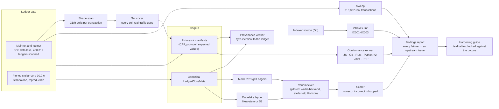

**Istravex — The XDR conformance and replay kit for Stellar**

### Project summary

Istravex is an open-source test kit that helps Stellar indexer and SDK maintainers verify that their software preserves what actually happened on the ledger. It uses a shared, versioned corpus of rare but valid Stellar XDR to answer two questions. Does the SDK decode and re-encode the data faithfully? Does the indexer store the right records and attribute them to the right accounts?

Built for **SCF #46 RFP 2** (XDR/CAP-Coverage Audit Tool and Indexer-Hardening Guide). Everything below is built, public and running in CI: a 137-fixture corpus that covers every XDR shape real mainnet and testnet traffic uses (chosen from a scan of 400,311 ledgers); 45,144 generated valid and hostile values of every XDR type, judged by stellar-core; the replay harness with three SDF indexers (wallet-backend, stellar-etl, Horizon); a conformance runner for seven SDKs plus a sweep over 310,837 real transactions; the Go linter; the hardening guide; a findings report with nine new defects; a threat model; and signed releases. The grant would put the kit inside the projects it tests, as CI jobs offered to seven SDKs and three indexers, and add four more SDKs, a TypeScript linter, three more indexers, automatic coverage of new shapes, the next protocol upgrade, and twelve months of maintenance.

- Repository: https://github.com/hackcat29/istravex (Apache 2.0)
- Docs: https://docs.istravex.com · API: https://api.istravex.com · Mock RPC: https://rpc.istravex.com

### Problem

A Stellar transaction can be valid and still be misread downstream. An indexer might miss a trustline created through a Stellar Asset Contract, store a muxed address where an account belongs, or attribute an effect to the wrong account. An SDK can decode an XDR value correctly and still lose information when it converts it to a language-native value. These mistakes propagate into wallets, explorers and analytics without a visible error, and in 2026 several of them halted production ingestion outright.

A regression test added to one SDK or indexer usually stays in that repository. Istravex lets maintainers share the original fixture, its expected result and the protocol context behind it, so a fix in one implementation becomes a test for all of them.

### What it does

**In plain English.** The corpus is a folder of real Stellar transactions and ledgers, each tied to the protocol changes (CAPs) whose shapes it exercises, with the values a correct decoder and a correct indexer must produce. A scanner read 400,311 mainnet and testnet ledgers and recorded every XDR shape each transaction uses; the corpus was then chosen so that every shape real traffic uses is in it. A verifier proves every fixture is byte-identical to the ledger that recorded it. Seven small programs, one per SDK, decode every fixture and check the values; they also decode 45,144 generated values, valid and deliberately malformed, of every XDR type, judged against stellar-core's own decoder; and a sweep checks five of them against stellar-core's own hashes for 310,837 real transactions. A fake Stellar RPC server, and an export in the same layout as SDF's public data lake, hand the same ledgers to any indexer, and a scorer compares what it stored with what it should have. Three of SDF's indexers run over it in CI: wallet-backend, stellar-etl and Horizon. A linter reads indexer source code for the mistakes that keep recurring. A findings file ties every failure to an issue upstream, and a guide explains each rule with the evidence.

**Stack.** Node 24 (corpus tooling, mock RPC, data-lake exporter, JavaScript runner, API), Go 1.26 (shape scanner, sweep, verifier, Go runner, `go/analysis` linter), Rust (stellar-xdr runner, the Soroban probe contract, sighting reproductions), Python 3, Java 17 and PHP 8 (their SDK runners), PostgreSQL 16 (the Horizon pilot), stellar-core 30.0.0 pinned by binary sha256, stellar-horizon 30.0.1, `@stellar/stellar-sdk` 17.4.0, `go-stellar-sdk` 0.9.0, `stellar-xdr` 30.0.0, Python `stellar-sdk` 17.0.1 and `stellar-xdr` 0.2.1, `java-stellar-sdk` 6.0.0, `stellar-php-sdk` 1.18.0, Mintlify for docs, GitHub Actions for CI, scans, sweeps and deploys.

### What's built

| Deliverable | What exists | RFP reviewer check |
|---|---|---|
| **Corpus and generator** | 137 fixtures: 95 from mainnet, 30 from testnet, 10 generated, 2 synthetic. 20 are hand-written patterns that broke real software; 116 were chosen by set cover so that **all 470 XDR cells real traffic uses** (union arms, flag bits, contract cost types; 603 are reachable from `LedgerCloseMeta`) are in the corpus. **45 of the 47 live CAPs that leave a ledger shape** are covered; the other 23 CAPs leave none, each with the reason. The generator runs a pinned standalone stellar-core, byte-reproducible, any passphrase, protocols 28–30. 1,794/1,794 provenance checks. | Every fixture round-trips through rs-stellar-xdr 30.0.0; all SDKs round-trip stellar-core's 15,306 `--check-lcm` golden frames. |
| **Replay harness** | Mock Stellar RPC `getLedgers` and the Galexie data-lake layout (filesystem or S3), bounded memory (542 MB of ledgers served under a 128 MB heap). **Three SDF indexers** replayed over every fixture with a transaction: wallet-backend's own ingestion, **123/123** correct over RPC and the data lake; Horizon 30.0.1's own `db reingest` into PostgreSQL, **123/123**; stellar-etl v2.8.35's own transforms, **119/123**, the four misses being its open issues #454 and #460. | wallet-backend #729, #731 and #716 reproduce on the commits before their fixes and pass on the fixes, in CI. |
| **Linter** | Three `go/analysis` rules: unvalidated fields used as if checked (IX001), walks with no depth or size limit (IX002), participants or fees from the envelope (IX003). A GitHub Action and a reusable workflow. | Flags all six seeded violations; clean on current wallet-backend apart from one triaged latent finding; flags the code #753 and 9538b3c fixed, on the commits before them. |
| **Hardening guide** | Nine rules, a field-by-field table of what stellar-core validates and passes through (15 rows), recommended limits with sources, SEP-0023 address handling, a checklist. Exports to Docusaurus for developers.stellar.org. | The field table is generated from one file and CI checks it against every manifest. A draft: review by a stellar-core or platform engineer, which the RFP gates publication on, is requested publicly (stellar/stellar-docs#3166) and is a tranche 2 acceptance criterion. The export opens with a "Draft, not reviewed" warning until then. |
| **Conformance runner** | **Seven SDKs** in CI: `@stellar/stellar-sdk` 17.4.0, `go-stellar-sdk` 0.9.0, `stellar-xdr` 30.0.0 (Rust), Python `stellar-sdk` 17.0.1 and `stellar-xdr` 0.2.1, `java-stellar-sdk` 6.0.0, `stellar-php-sdk` 1.18.0. 2,810/2,816 checks; every failure is a finding. A **sweep** over 1,241 whole ledgers checks the SDKs against stellar-core's own bytes: every ledger round-trips, and Go, JavaScript, Rust and Python match all 310,837 transaction hashes stellar-core recorded; Java misses 58 (F-0023). Plus four JavaScript releases. **Generated cases:** 45,144 values of every XDR type (12,134 valid, 33,010 trailing-byte, truncated or bad-flag), deterministic from a seed, through every SDK, with stellar-core 30.0.0 as the oracle (672/672). Together with the corpus they reach all 603 reachable cells. | js-stellar-sdk 17.2.0 and 17.2.1 fail exactly the checks for #1766, #1785 and #1789; 17.3.0 and 17.4.0 pass. |
| **Findings report** | 28 findings: **9 new defects** the kit found (all 9 filed upstream), 15 known bugs reproduced, 4 notes; each with severity, affected versions, disclosure route, the corpus entry and the checks it explains; served at `/v1/findings`. | CI fails on any failure that no finding explains, in the runners, the generated cases, the pilots and the sweeps. |

### New defects

The kit's value is the bugs it finds that nobody had reported. Nine so far:

| Finding | Component | Severity | What |
|---|---|---|---|
| F-0023 | java-stellar-sdk 6.0.0 | medium | A transaction whose `PRECOND_V2` fields are all defaults is rebuilt as `PRECOND_TIME`, so its hash is wrong and signing it signs a different transaction. 58 of 307,577 mainnet transactions in the sweep; Go, JavaScript, Rust and Python hash all of them correctly. Filed: java-stellar-sdk#844. |
| F-0024 | stellar-php-sdk 1.18.0 | medium | The same defect in PHP, with the same wrong hash. Filed: stellar-php-sdk#222. |
| F-0021 | stellar-php-sdk 1.18.0 | medium | Muxed account IDs above 2⁶³ come back negative: a real mainnet destination, 18067157809773112502, reads as -379586263936439114. Filed: stellar-php-sdk#220. |
| F-0022 | stellar-php-sdk 1.18.0 | low | The decoder accepts 101 operations and a 29-byte memo, past their XDR maximums. Filed: stellar-php-sdk#221. |
| F-0027 | stellar-php-sdk 1.18.0 | low | Trailing bytes after a complete value are ignored: 9,845 generated cases across 406 types decode, which stellar-core and the other SDKs refuse. Java fixed the same defect in #842. Filed: stellar-php-sdk#223. |
| F-0028 | stellar-php-sdk 1.18.0 | info | Seven standalone XDR classes (`DataValue`, `SponsorshipDescriptor`, the overlay hash vectors) don't match the XDR; the ledger decoders don't use them. Filed: stellar-php-sdk#224. |
| F-0012 | js-stellar-sdk | low | `TransactionBuilder` refuses a muxed source or memo on every Soroban transaction. Filed: js-stellar-sdk#1906. |
| F-0010, F-0011 | stellar-core | low | Operation-meta change order differs between identical runs; settings-upgrade salts make standalone networks unreproducible. Filed: stellar-core#5507, #5508. |

All nine are filed upstream, each with its reproduction in the corpus; the kit shows each fix landing on the next run.

### Mainnet

The corpus is mainnet-first and measured against real traffic. `kit/go/cmd/shape-scan` streams SDF's public data lake and records every XDR cell each transaction and ledger exercises; a GitHub workflow runs it in 16 shards.

| Scan | Ledgers | Transactions |
|---|---|---|
| Mainnet, every 400th and every 37th ledger since 59,227,201 (Horizon's history) | 186,253 | 57,628,208 |
| Testnet since its last reset (protocol 30 since 5,540,313) | 214,046 | 2,002,380 |
| Mainnet and testnet protocol-upgrade ledgers (24–30) | 12 | 1,956 |

470 of the 603 reachable cells occur in those ledgers. The corpus covers all of them, with expected values from Horizon and bytes from the canonical ledger. Its earlier pattern scan found the hand-written patterns in production: 122,485 transactions with vectors at their maximum, 100,999 muxed IDs above 2⁵³, 63,778 authorization trees three or more deep, 5 SAC `trust()` trustlines in 400,000 ledgers.

### Security

- **Policy.** [SECURITY.md](https://github.com/hackcat29/istravex/blob/main/SECURITY.md): GitHub private vulnerability reporting, acknowledgement within 3 business days, triage within 7, a fix within 30 for high or critical issues.
- **Disclosure of what the kit finds.** Every finding records its disclosure route. A finding that could halt ingestion, corrupt balances or be triggered by anyone submitting a transaction goes privately to the maintainer, or through SDF's bug bounty for stellar-core and SDF repositories, under a 90-day embargo, before any public issue or fixture. Low-severity findings are public issues. The record is in SECURITY.md and `corpus/findings.json`.
- **Attack surface.** The kit holds no keys or funds and signs nothing outside its own standalone network. The hosted API and RPC are read-only, serve committed files, and are rate limited. Every dependency is pinned by version and, for stellar-core and the Java jars, by sha256.
- **Threat model.** [THREAT-MODEL.md](https://github.com/hackcat29/istravex/blob/main/THREAT-MODEL.md) answers SDF's four questions and goes through STRIDE for the corpus, the runners, CI, the hosted API and RPC, and the releases: twelve threats, each with its control and how it is monitored.
- **Monitoring and releases.** A weekly workflow opens an issue when any pinned dependency (stellar-core, the seven SDKs, the three indexers) has a newer release, checks the hosted services, and scans the week's new ledgers for XDR cells the corpus lacks. Releases are built in CI only from a commit on `main` that passed CI, with SHA256SUMS and signed build-provenance attestations (`gh attestation verify`).
- **Audit history.** No third-party audit; there is nothing custodial to audit, and audits are an ineligible cost. The kit's own correctness is checked the way it checks others: byte-identical provenance against the ledger, reproducible regeneration, and calibration against known bugs.

### Team

Istravex is built by **Istravex Labs**, a software, mobile and blockchain development studio with two core engineers and contract staff. The studio's projects, Payrouta among them, are used by thousands of people and have processed millions of dollars, and it has won hackathons and grants from Solana, Sui, Algorand, BNB Chain, Wormhole and others.

**Tomiwa Adeyemi, core maintainer** ([GitHub](https://github.com/hackcat29), [X](https://x.com/hackcat_29), [LinkedIn](https://www.linkedin.com/in/tomiwa-adeyemi)). Eight years in the blockchain industry, previously at Scroll Foundation and HUMAN Protocol. Winner of multiple hackathons, and a member of Stellar Nigeria. Founder of [Payrouta](https://payrouta.com), a universal checkout widget: a merchant, app, agent or store adds one checkout button, and its customers pay from whatever wallet, blockchain (Stellar included) or token they hold. Payrouta depends on reading Stellar payments correctly, which is the problem Istravex tests for. Tomiwa built everything listed above and owns fixture review, triage and releases.

**Richard Oyedeji, product engineer and designer** ([X](https://x.com/r_omotayo_), [LinkedIn](https://www.linkedin.com/in/richard-oyedeji-b30066211/)). More than eight years building and designing products, previously at Little Unusual, and currently motion designer at Outcome.xyz, a top-five prediction market by volume. On Istravex he owns the site, the docs and the reports, and shares the new SDK runners and the TypeScript linter.

### Evidence of reproducing a listed sighting

All six sightings the RFP's deliverable checks name reproduce in CI, failing before the fix and passing after:

- **wallet-backend #729** (signed-payload signers): on `2a0a84e` the signer's state change can't be encoded (a 68-byte key into a 33-byte column), so ingestion would retry the ledger forever. On `2c87335`: correct.
- **wallet-backend #731** (SAC trustlines): on `764a4f5` no `TRUSTLINE` state change is recorded. On `c152783`: correct.
- **wallet-backend #716** (fixed by #753): on `f8e5786` the muxed source's `G…` and `M…` forms collide on one participant key, which halted ingestion; IX003 flags the four lines #753 changed. On `bb0b162`: correct, and no findings.
- **js-stellar-sdk #1766, #1785, #1789**: 17.2.0 throws decoding a valid pool-share trustline and mis-sorts map keys; 17.2.1 accepts `0x…` muxed IDs, rounds offer IDs above 2⁵³, and silently drops two of ten map entries. 17.3.0 passes every check.

Of all 18 sightings the RFP lists, **13 are reproduced** before and after their fixes (or at the current release, where the fix is unreleased or the issue open): the six above plus wallet-backend #753, stellar-etl #454 and #460, rs-stellar-xdr #581 and #598, rs-soroban-sdk #2099 and js-xdr #165. Three are exercised without a before/after (stellar-core #5435's goldens, stellar-etl #470's protocol 28 XDR, js-stellar-sdk #1823's documented behaviour), and two are out of reach with the reason (henyey #3941 is bucket parsing; rs-stellar-xdr #604 is a schema-file defect no release shows). The registry and its checks: https://docs.istravex.com/corpus/sightings.

### Infrastructure and decentralization

Nothing in the kit depends on a server Istravex runs. Every tool runs locally or in a user's CI from a clone: the corpus, verifier, runners, mock RPC, data-lake exporter, scorer and linter. The hosted services are conveniences over the same files: istravex.com (static site, Cloudflare Workers), docs.istravex.com (Mintlify), and api.istravex.com and rpc.istravex.com (one read-only container on a VPS, deployed by GitHub Actions, and self-hostable as one Docker image). Mainnet fixtures are pinned to SDF's public data lake by sha256, so anyone can re-derive them independently.

### User tracking

Minimal, and documented at https://docs.istravex.com/project/maintenance#user-tracking. Istravex adds no cookies, analytics or request logs anywhere: Cloudflare Workers observability and nginx access logs are off. The API keeps a per-IP rate-limit counter in memory for one minute. Mintlify records docs page views for its own dashboard, as it does for every site it hosts. The kit's tools collect nothing.

### Budget and tranches

Everything above is built and is not part of the request: past work is ineligible. The award funds new work over six months, plus twelve months of maintenance from the award.

**Request: $55,000 in XLM.** 1,180 engineering hours at a blended $45 an hour, plus $1,900 of infrastructure for twelve months. The rate is what a two-engineer studio in Nigeria costs, not a market rate; the hours are sized from what the built work took.

| Work | Hours | Cost |
|---|---|---|
| **The kit inside the projects it tests.** A conformance job offered as a pull request to each of the seven SDK repositories and the three indexers (wallet-backend, stellar-etl, Horizon): the corpus and generated cases on every pull request, a failure naming the finding. Kept working as they change. | 150 | $6,750 |
| **Four more SDKs, for eleven:** Swift (`stellar-ios-mac-sdk`), Dart (`stellar_flutter_sdk`), .NET (`dotnet-stellar-sdk`) and Kotlin, each through the corpus, the generated cases and the sweep, with a release matrix | 200 | $9,000 |
| **A linter for TypeScript indexers:** IX001–IX003 ported to an ESLint plugin, then IX004 (amounts through floats), IX005 (effects read from operations, not metadata) and IX006 (unbounded strkey and memo decoding) in both Go and TypeScript, each calibrated on a seeded violation and a real bug | 160 | $7,200 |
| **Three more indexer pilots:** SDF's token transfer processor (CAP-0067 events) and two community indexers chosen with SCF reviewers, scored over RPC and the data lake, every failure a finding | 170 | $7,650 |
| **Coverage that keeps up on its own:** the sweep on every week's new ledgers; a fixture captured, verified and opened as a pull request automatically for any new cell the weekly scan finds; a monthly report; CAP-0070 and CAP-0083 closed | 120 | $5,400 |
| **The next protocol upgrade end to end:** re-pin, rescan, regenerate, re-run, release within two weeks of the mainnet vote | 120 | $5,400 |
| **Guide v2:** rules from the new findings, the stellar-core or platform engineer review the RFP requires (requested in stellar/stellar-docs#3166), a pull request to developers.stellar.org | 80 | $3,600 |
| **Twelve months of maintenance:** following every finding upstream to a fix (nine filed so far), triage, the pins the weekly monitor flags, releases, a quarterly report | 180 | $8,100 |
| Infrastructure for twelve months, at cost: the API and RPC host, a runner for the PostgreSQL-backed indexer pilots, domains, storage for the data-lake export | | $1,900 |
| **Total** | **1,180** | **$55,000** |

For comparison: Build awards are capped at $150,000; SCF #45 made four RFP-track awards totalling $445,000 (about $111,000 each); SCF #44 awarded LumenWipe $120,000; SCF #41 awarded a Soroban reverse-engineering tool $120,000; SCF #40 awarded a Unity kit $47,000. Istravex asks for half the RFP-track average because the RFP's deliverables are already built and the rate is frugal; the award pays for putting the kit inside the projects it tests and keeping it current.

| Tranche | Share | Amount | Due | Deliverables (each testable from a clean checkout or a public link) |
|---|---|---|---|---|
| **T0 · Award** | 10% | $5,500 | On award | Funded-work plan published as GitHub milestones; the weekly sweep running; a fix offered as a pull request for each of the six SDK defects filed on 18 November |
| **T1 · MVP** | 20% | $11,000 | Month 2 | Conformance-job pull requests opened to all seven SDK repositories; Swift and Dart runners in CI; the TypeScript linter with IX001–IX003, flagging its seeded violations |
| **T2 · Testnet** (public beta) | 30% | $16,500 | Month 4 | .NET and Kotlin runners in CI (eleven SDKs); conformance-job pull requests opened to the three indexers; the token-transfer-processor pilot; IX004–IX006 in Go and TypeScript; automatic capture of new cells; the guide reviewed and proposed to developers.stellar.org; v1.4 released |
| **T3 · Mainnet** (production release) | 40% | $22,000 | Month 6 | The two community-indexer pilots; the next protocol upgrade covered end to end (or, if its vote is later, its release candidate); every open finding followed up upstream; v2.0.0 released; maintenance continuing to month 12, with quarterly reports and a twelve-month report |

Each tranche follows the previous payment within 90 days, and every deliverable is checked by a command or a link a reviewer can open.

### Community

Istravex is promoted, and its results are posted, on every Stellar channel available to it:

- **Stellar's developer Discord**, in the SCF and developer channels: each release, each new finding, and a call for indexers to pilot.
- **Stellar Nigeria**, where the maintainer is a member: workshops on running the kit against your own indexer.
- **GitHub**: releases with notes, Discussions for questions and fixture proposals, and issues filed upstream for every finding.
- **The docs changelog** at docs.istravex.com, and the monthly rare-pattern report.
- **X, Bluesky, Mastodon and Matrix**: release and report announcements from the maintainer's accounts.
- **SCF**: tranche reports in the format the handbook asks for, and the six-month maintenance report.

### Open-source maintenance

Apache 2.0, developed in public, with tagged releases and a public changelog. Istravex Labs maintains it for twelve months from the award: Tomiwa Adeyemi owns fixture review, dependency updates, issue triage and releases, and Richard Oyedeji the site, the docs and the reports, through the first protocol upgrade after it. On that upgrade, every step is a command and CI stays red until it's done: audit the new CAPs, re-pin stellar-core, move the SDK pins and the probe contract, regenerate (and prove regeneration reproducible on both platforms), re-run the pilots, triage any new failure into a finding with an upstream issue, and release. Progress is posted on every channel listed under Community with each release.
